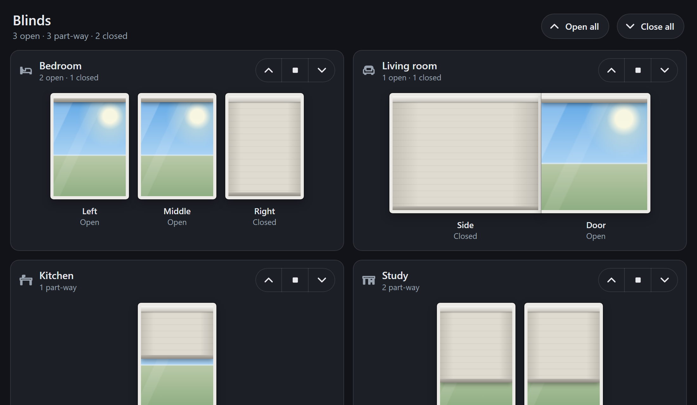
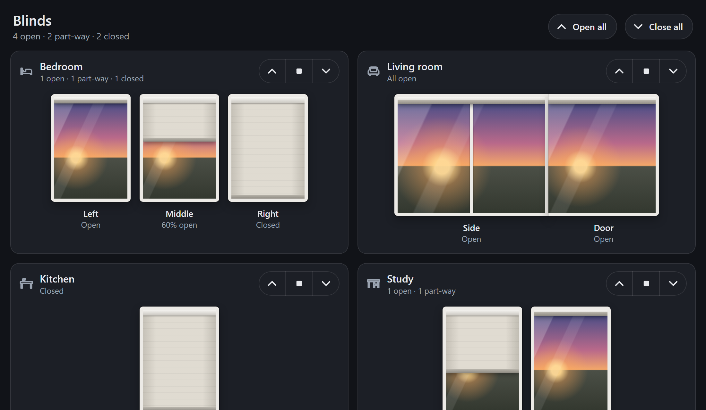
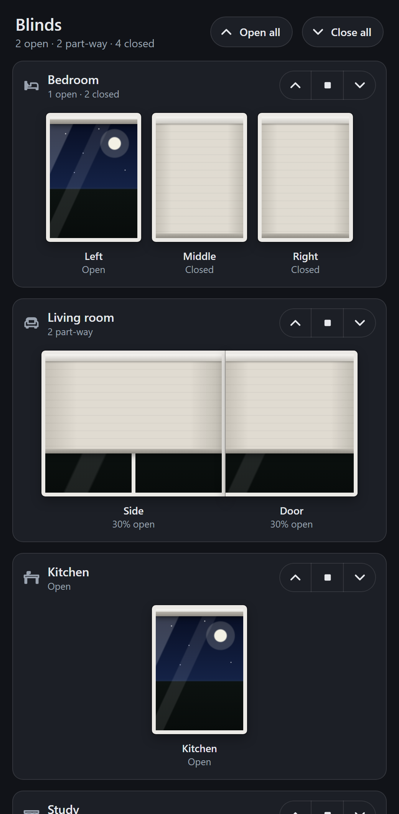

# Arcane Blind Windows

A Home Assistant card that draws every room as its windows, with each blind at its real height. Tap a window to open or close its blind, or drag it to any height. The blinds slide as they move, and the sky outside follows the sun: day, dusk and a starry night.

[![hacs][hacs-badge]][hacs-link]
[![Buy Me a Coffee][bmc-badge]][bmc-link]



<p>
  
  
</p>

- **Tap a window** to open or close it. Tap again while it moves to stop it.
- **Drag a blind** up or down to any height. It moves when you let go.
- **Room buttons** open, stop or close every blind in the room. **Open all** and **Close all** do the whole card.
- **Works without feedback.** Many blind hubs never say where a blind is. The card draws it moving at its real speed, then settles on what Home Assistant reports.
- Windows, doors and wide windows, side by side or sharing a frame.
- One column on a phone, two on a tablet, four on a wide screen.

Works with any `cover` entity: roller blinds, curtains, shades, shutters, garage-style screens. Somfy, NEO Smart Blinds, IKEA, Zigbee, Z-Wave, Shelly, Tuya and so on.

## Install

### HACS (recommended)

1. In HACS, open the three-dot menu, choose **Custom repositories**, add `https://github.com/deekay2153/arcane-blind-windows` with the type **Dashboard**.
2. Search for **Arcane Blind Windows** and download it.
3. Reload your browser.

### By hand

1. Download `arcane-blind-windows.js` from the [latest release](https://github.com/deekay2153/arcane-blind-windows/releases/latest).
2. Put it in `config/www/`.
3. In **Settings → Dashboards → ⋮ → Resources**, add `/local/arcane-blind-windows.js` as a **JavaScript module**.

## Quick start

Add **Arcane Blind Windows** from the card picker. It starts with your blinds already grouped into rooms by area. Then open the code editor to name them and choose shapes, or paste:

```yaml
type: custom:arcane-blind-windows
title: Blinds
rooms:
  - name: Bedroom
    icon: mdi:bed
    blinds:
      - entity: cover.bedroom_left
        name: Left
      - entity: cover.bedroom_right
        name: Right
  - name: Living room
    icon: mdi:sofa
    blinds:
      - entity: cover.living_room_door
        name: Door
        shape: door
        travel: 30
```

The card is made to fill the width, so it looks best in a **Panel** view or a full-width section.

## Options

### Card

| Option | Default | |
| --- | --- | --- |
| `title` | `Blinds` | The heading |
| `header` | `true` | `false` hides the heading and the Open all / Close all buttons |
| `stagger` | `0` | Seconds between blinds when several move at once, 0 to 10. Some hubs drop commands sent together; try `2`. |
| `fabric` | `#dcd7cc` | Colour of the blinds, any CSS colour |
| `rooms` | required | A list of rooms |

### Rooms

| Option | |
| --- | --- |
| `name` | The room's name |
| `icon` | Any `mdi:` icon (optional) |
| `blinds` | A list of blinds (at least one) |

### Blinds

| Option | Default | |
| --- | --- | --- |
| `entity` | required | A `cover` entity |
| `name` | none | Shown under the window |
| `travel` | `20` | Seconds from fully open to fully closed. Used to draw the blind moving, so time yours once for the smoothest picture. |
| `shape` | `window` | `window` or `door` (taller, with a middle bar) |
| `panes` | `1` | How wide it is drawn: `2` is twice as wide |
| `join` | `false` | `true` draws it in the same frame as the blind before it, like the two halves of a sliding door |
| `bar` | `true` | Doors only: `false` hides the middle bar |

## Good to know

- **Dragging** needs a cover that can go to a position. Covers that only open and close still open and close with a tap.
- **The sky** comes from `sun.sun`. Without it the windows stay in daylight.
- **Stagger** runs in your browser: if you close the page during a staggered Open all, the blinds not yet started stay where they are.
- **Other changes show up too.** When an automation or a remote moves a blind, the picture follows.

## Try it without Home Assistant

`preview/index.html` runs the card on made-up blinds. From the repo folder:

```
python -m http.server 8800
```

then open <http://127.0.0.1:8800/preview/index.html>. Options: `?sky=dusk` or `?sky=night`, `?stagger=1`.

## Support

If this card makes your blinds a little nicer to use, you can [buy me a coffee][bmc-link]. Thank you!

Found a bug or have an idea? [Open an issue](https://github.com/deekay2153/arcane-blind-windows/issues).

## Licence

MIT, see [LICENSE](LICENSE).

[hacs-badge]: https://img.shields.io/badge/HACS-Custom-41BDF5.svg
[hacs-link]: https://hacs.xyz
[bmc-badge]: https://img.shields.io/badge/Buy%20me%20a%20coffee-FFDD00?logo=buymeacoffee&logoColor=black
[bmc-link]: https://www.buymeacoffee.com/deekay2153
